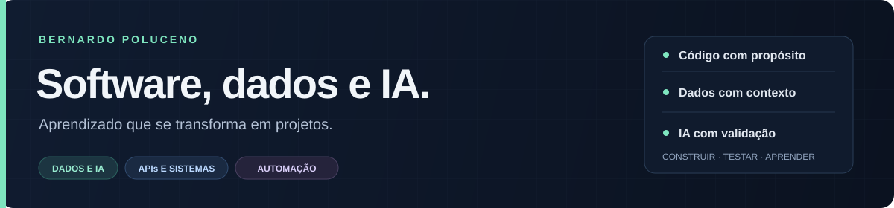

  

# Olá, eu sou o Bernardo 👋

**Estudante de Ciência de Dados e Inteligência Artificial na UniSENAI, com formação técnica em Análise e Desenvolvimento de Sistemas.**

Construo projetos para transformar o que estudo em aplicações que funcionam: APIs, interfaces, bancos de dados e automações. Meu interesse está em aproximar desenvolvimento de software, análise de dados e IA aplicada, com atenção à organização do código, aos testes e à resolução de problemas.

**Busco oportunidades de estágio** em Dados/IA, desenvolvimento de sistemas ou suporte técnico N1.

---

## Projetos em destaque

### Job Radar · IA aplicada e automação

Aplicação local para organizar vagas de tecnologia e adaptar currículos com modelos de linguagem.

- Coleta em fontes públicas, filtros de perfil e deduplicação de anúncios.
- Adaptação de currículos com validação de evidências para preservar as informações do documento original.
- Integração com Telegram e Hermes, buscas agendadas e serviços iniciados sob demanda.
- Persistência em PostgreSQL, testes de API e interface e validação com GitHub Actions.

**Stack:** Python, FastAPI, PostgreSQL, Next.js, React, TypeScript, Docker, LLMs, Pytest e Playwright.

*Projeto de uso local · repositório privado.*

### Trekit · Compartilhamento de trilhas

Plataforma com usuários, trilhas e interações sociais. Minha atuação está no desenvolvimento da API e na integração com a interface.

- API REST com Node.js e Express e modelagem dos dados em PostgreSQL.
- Autenticação com JWT e proteção de senhas com Bcrypt.
- Upload e armazenamento de imagens com Multer e Cloudinary.

**Stack:** Node.js, Express, PostgreSQL, JWT, Bcrypt, Cloudinary e React.

[Ver back-end](https://github.com/Bernardo-03P/Back-End-Trekit) · [Ver front-end](https://github.com/Bernardo-03P/Front-End-Trekit)

### VCR Digital · Interface e gerenciamento de depoimentos

Aplicação web com interface responsiva e gerenciamento de depoimentos, conectando front-end, API e banco de dados.

- Interface em React, com comunicação HTTP via Axios.
- Operações de cadastro, consulta, edição e exclusão de depoimentos.
- API em Node.js e Express com persistência em PostgreSQL.

**Stack:** React, CSS, Axios, Node.js, Express e PostgreSQL.

[Ver front-end](https://github.com/Bernardo-03P/VCR-Front) · [Ver back-end](https://github.com/Bernardo-03P/VCR-Back)

---

## Tecnologias na prática

| Área | Tecnologias utilizadas nos projetos |
| --- | --- |
| **APIs e back-end** | Python, FastAPI, JavaScript, Node.js e Express |
| **Interfaces** | React, Next.js, TypeScript, HTML, CSS e Tailwind CSS |
| **Banco de dados** | SQL e PostgreSQL |
| **Automação e qualidade** | Git, GitHub, Docker, Pytest, Playwright e GitHub Actions |
| **Integrações** | APIs REST, JWT, Cloudinary, Telegram e LLMs |

## O que estou aprofundando

- **Dados:** Python, Pandas, NumPy, SQL e análise exploratória.
- **Inteligência artificial:** fundamentos de aprendizado de máquina e uso de modelos de linguagem em aplicações.
- **Engenharia de software:** testes automatizados, validação de dados e organização de APIs.

Minha formação em sistemas é a base para avançar em Dados e IA: aprender com projetos, investigar problemas e melhorar cada entrega.
